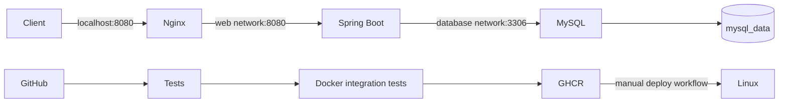

# Task Manager DevOps Lab

Project portfolio của **Trần Mạnh Khiêm**: REST API quản lý công việc với Spring Boot, MySQL, Docker Compose, Nginx và GitHub Actions. Có CI kiểm thử/publish image và workflow CD triển khai thủ công lên Linux.

## Kiến trúc



Chỉ Nginx công khai cổng, mặc định bind localhost. API và MySQL không publish cổng ra host. Database dùng mạng nội bộ và volume riêng. Flyway quản lý schema; Hibernate kiểm tra schema khi khởi động. API chạy bằng user không phải root trong container.

## Chạy nhanh trên Windows

Cần Docker Desktop đang chạy với Linux containers và Docker Compose v2 hỗ trợ `--wait`. Không cần Java/MySQL trên host khi chạy bằng Docker. Python 3 chỉ cần cho smoke test.

Mở PowerShell tại thư mục project:

```powershell
Copy-Item .env.example .env
# Đổi hai mật khẩu trong .env trước khi chạy.
docker compose up -d --build --wait --wait-timeout 240
Invoke-RestMethod http://localhost:8080/health
python scripts/smoke-test.py
```

Health mong đợi: `status: UP`. Project này cung cấp API, chưa có giao diện web. Truy cập `/` trả 404 là bình thường.

Thử CRUD:

```powershell
$body = @{title='Learn Docker'; description='Build my first image'; status='TODO'} | ConvertTo-Json
$task = Invoke-RestMethod -Method Post -Uri http://localhost:8080/api/tasks -ContentType 'application/json' -Body $body
Invoke-RestMethod "http://localhost:8080/api/tasks/$($task.id)"
Invoke-RestMethod 'http://localhost:8080/api/tasks?status=TODO&page=0&size=20'
$update = @{title='Learn Docker'; description='Image built'; status='DONE'} | ConvertTo-Json
Invoke-RestMethod -Method Put -Uri "http://localhost:8080/api/tasks/$($task.id)" -ContentType 'application/json' -Body $update
Invoke-RestMethod -Method Delete -Uri "http://localhost:8080/api/tasks/$($task.id)"
```

## API

| Method | Endpoint | Kết quả |
|---|---|---|
| GET | `/health` | 200 khi API và database sẵn sàng |
| POST | `/api/tasks` | 201, task mới và header Location |
| GET | `/api/tasks?page=0&size=20&status=TODO` | Trang task mới nhất trước; status tùy chọn |
| GET | `/api/tasks/{id}` | 200 hoặc 404 |
| PUT | `/api/tasks/{id}` | Thay thế title, description, status; 200 hoặc 404 |
| DELETE | `/api/tasks/{id}` | 204 hoặc 404 |

Body POST/PUT: `title` bắt buộc, tối đa 150 ký tự; `description` tùy chọn, tối đa 2000 ký tự; `status` bắt buộc và thuộc `TODO`, `IN_PROGRESS`, `DONE`. Trang bắt đầu từ 0, size từ 1 đến 100. Input không hợp lệ trả 400. `id` và `createdAt` do server tạo.

## Kiểm thử Java

Dùng JDK 17 và Maven 3.9+ (Docker/CI cũng dùng Java 17):

```powershell
mvn -B verify
```

Tests chạy API với Spring context, JPA, Flyway và H2 ở chế độ tương thích MySQL. H2 không thay thế kiểm thử MySQL thật: job integration trên CI chạy đầy đủ MySQL + API + Nginx, smoke test và kiểm tra dữ liệu còn sau khi tạo lại container.

Muốn chạy trực tiếp với MySQL có sẵn, cần tạo database `taskmanager` và user trước:

```powershell
$env:DB_URL='jdbc:mysql://localhost:3306/taskmanager'
$env:DB_USER='taskuser'
$env:DB_PASSWORD='your-local-password'
mvn spring-boot:run
```

Khi chạy trực tiếp, health ở `/actuator/health`; API ở `/api/tasks`. Không chạy đồng thời Nginx trên cùng cổng 8080.

## CI và CD

Đưa **nội dung thư mục này vào root của repository GitHub riêng** để GitHub nhận `.github/workflows`.

- Pull request: Maven verify → build/chạy Docker stack → smoke test → kiểm tra persistence.
- Push `main`: sau khi các kiểm thử pass, publish `ghcr.io/<owner>/<repo>:<commit-sha>` và `:latest` bằng GITHUB_TOKEN.
- Workflow `Deploy to Linux server`: chạy thủ công, nhận SHA đầy đủ của image đã được CI publish. Image theo SHA giúp truy vết và triển khai lại phiên bản cũ.

Xem [docs/DEPLOYMENT.md](docs/DEPLOYMENT.md) để chuẩn bị server và secrets. Chưa có repository GitHub hoặc server được kết nối tự động bởi project này.

## Vận hành và xử lý lỗi

```powershell
docker compose ps
docker compose logs -f api
docker compose logs mysql nginx
docker compose down
# Khởi động lại, giữ nguyên dữ liệu:
docker compose up -d --wait --wait-timeout 240
```

- Không nhận diện lệnh docker: cài Docker Desktop, khởi động ứng dụng và mở terminal mới.
- Thiếu DB_PASSWORD: copy `.env.example` thành `.env` trong đúng thư mục project.
- Cổng 8080 bận: đổi HTTP_PORT trong `.env`, sau đó dùng URL mới. Với smoke test, đặt `$env:BASE_URL='http://localhost:8081'` nếu dùng cổng 8081.
- Database unhealthy: xem logs MySQL. Đổi mật khẩu trong `.env` không thay mật khẩu database đã tồn tại trong volume; cần đổi user trong MySQL hoặc phục hồi cấu hình cũ.
- Nginx 502 sau khi thay API container: chạy `docker compose restart nginx` để phân giải lại địa chỉ API.
- `docker compose down --volumes` xóa volume database. Không dùng nếu muốn giữ dữ liệu; CI chỉ dùng với dữ liệu kiểm thử tạm thời.

## Nội dung CV sau khi tự chạy và hiểu project

**Task Manager DevOps Lab | Java, Spring Boot, MySQL, Docker, Nginx, GitHub Actions**

- Developed REST APIs with input validation, pagination, status filtering, and versioned database migrations.
- Containerized the application using a multi-stage Dockerfile and Docker Compose with persistent MySQL storage and Nginx reverse proxy.
- Implemented GitHub Actions workflows for API tests, container integration tests, and publishing Docker images to GHCR.

Chỉ thêm kinh nghiệm triển khai Linux khi bạn đã cấu hình server và chạy workflow deploy thành công. Xem [docs/LEARNING.md](docs/LEARNING.md) để học và chuẩn bị phỏng vấn.

Tài liệu: [Spring Boot](https://docs.spring.io/spring-boot/3.5/), [Docker Compose](https://docs.docker.com/compose/), [GitHub Actions](https://docs.github.com/en/actions).
