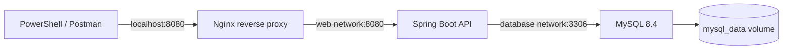

# Task Manager DevOps

Ứng dụng API quản lý công việc, được xây dựng để thực hành **đóng gói, kết nối và triển khai một hệ thống bằng các công cụ DevOps**.

Ví dụ: tạo công việc “Học Docker”, xem danh sách, chuyển trạng thái từ `TODO` sang `DONE`, rồi xóa khi không còn cần. Dữ liệu được lưu trong MySQL.

Project hiện cung cấp **REST API trả về JSON**, chưa có giao diện web. thao tác bằng PowerShell, Postman hoặc công cụ gọi HTTP khác.

## Mục tiêu

- Xây dựng API bằng Java/Spring Boot và lưu dữ liệu trong MySQL.
- Viết Dockerfile để đóng gói ứng dụng thành image.
- Dùng Docker Compose để chạy API, MySQL và Nginx cùng nhau.
- Cấu hình Nginx làm reverse proxy và hiểu luồng request.
- Thực hành network, volume, biến môi trường và health check.
- Dùng GitHub Actions để kiểm thử, build, publish image và triển khai lên Linux.

## Chức năng

- Tạo, xem, sửa và xóa công việc (CRUD).
- Ba trạng thái: `TODO`, `IN_PROGRESS`, `DONE`.
- Lọc theo trạng thái và phân trang, sắp xếp công việc mới nhất trước.
- Kiểm tra dữ liệu đầu vào, trả lỗi 400 khi không hợp lệ và 404 khi không tìm thấy task.
- Quản lý schema database bằng Flyway và kiểm tra sức khỏe ứng dụng qua HTTP.

Mỗi công việc có `id`, `title`, `description`, `status`, `createdAt`. Server tự tạo `id` và `createdAt`.

## Kiến trúc và luồng request

Khi gửi `POST /api/tasks`, Nginx chuyển request đến Spring Boot. Ứng dụng kiểm tra dữ liệu, lưu công việc vào MySQL và trả lại JSON qua Nginx.

Chỉ Nginx mở cổng ra máy host, mặc định là `127.0.0.1:8080`. API và MySQL giao tiếp qua mạng Docker; MySQL có mạng nội bộ riêng. Volume giữ dữ liệu khi container được xóa và tạo lại.
